<h1 align="center">◆ Movix</h1>

<p align="center">
  <b>Describe a character. Claude shapes it in Blender. Get game-ready 2D animations.</b><br>
  <sub>Karakteri tarif et. Claude Blender'da şekillendirsin. 2B oyun animasyonların hazır olsun.</sub>
</p>

<p align="center">
  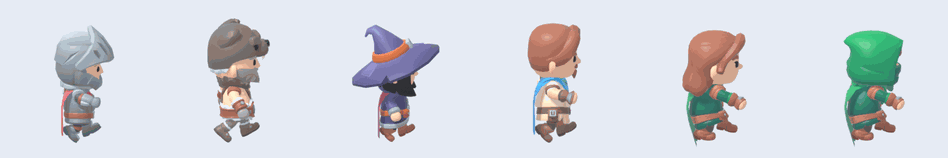
</p>

<p align="center">
  
  
  
  
  
</p>

<p align="center"><b>🇬🇧 English</b> &nbsp;·&nbsp; <a href="#-türkçe">🇹🇷 Türkçe</a></p>

---

# 🇬🇧 English

## What it does

Movix is a small desktop app that turns a one-line description into **2D character animations** (walk right, walk left, idle) for your game.

You type *"a cheerful wizard in a green robe"*. **Claude** then drives an open **Blender** window: it picks the closest of six ready-made toy-style characters,
swaps parts, repaints it and chooses a fitting walk. You get **transparent PNG frames** and a **sprite sheet**.

| Walk right | Walk left | Idle |
|:-:|:-:|:-:|
| 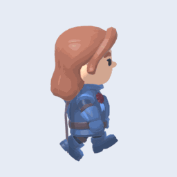 | 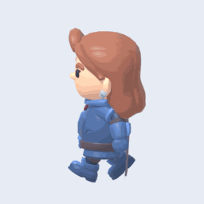 | 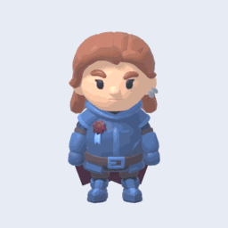 |

<p align="center"><sub>"Blue steel knight": the Knight's armour tinted blue, the Rogue's head swapped in.</sub></p>

## How a character is made

Claude does **not** model anything. It edits a ready-made character with a handful of tools:

| Step | Tool | What it does |
|---|---|---|
| 1. Pick | `new_character` | Loads the closest of 6 bases: Knight, Barbarian, Mage, Ranger, Rogue, Rogue Hooded |
| 2. Mix | `use`, `remove` | Swaps heads, bodies, arms, legs, hats, helmets and capes between bases (they share one skeleton) |
| 3. Paint | `swatches`, `replace_color`, `tint`, `shift_color` | Repaints exact regions (skin, hair, shirt) or whole parts, keeping the painted detail |
| 4. Shape | `resize`, `scale_all` | Fat, thin, big-headed, short-legged bodies |
| 5. Move | `animate` | Picks a walk and idle that match the personality (calm, bouncy, sneaky, running…) |

There are **no accessories, hand-held items or bags**, by design: they spoiled the designs.
Claude gets a budget (about 16 tool calls / 9 minutes); if it runs over, the character is finished as it stands, so you always get a result.

## Install

In Windows PowerShell, one after another:

```powershell
winget install BlenderFoundation.Blender.LTS.4.5
winget install Anthropic.ClaudeCode
winget install Python.Python.3.12

claude                      # sign in once (no API key needed, you use your account), then exit

git clone https://github.com/mhmtemnbgr1/MOVIX.git
cd MOVIX
python -m movix.app         # or double-click Baslat.bat
```

Open a **new** PowerShell window after the `winget install` lines so the new programs are found. Quick check:

```powershell
python --version            # 3.10 or newer
claude --version            # the assistant CLI the app drives
```

No `winget`? Install the three programs by hand: [Blender](https://www.blender.org/download/) (4.2 or newer), [Python](https://www.python.org/downloads/) (3.10 or newer, tick *Add python.exe to PATH*) and [Claude Code](https://claude.com/claude-code).

No `pip install` needed: the app only uses Python's standard library.
Blender opens by itself. When the header shows *Blender connected* and *Claude ready*, you are good to go.
If Blender lives elsewhere, use **Choose Blender…** to point to `blender.exe`.
The **🌐 EN / TR** button switches the app language; your choice is remembered.

**Troubleshooting**

| Problem | Fix |
|---|---|
| *Blender not found* in the header | Click **Choose Blender…** and select `blender.exe` (usually `C:\Program Files\Blender Foundation\Blender 4.5\`) |
| *Claude Code missing* | Install it (see above) and restart the app |
| It starts but nothing is built | Run `claude` once in PowerShell and finish signing in, then try again |
| `python` is not recognised | Reopen PowerShell after installing Python, or reinstall with *Add python.exe to PATH* ticked |

## Usage

1. Describe the character, e.g. *"a cheerful wizard in a green robe"*.
2. Press **★ Suggest 3 characters**, then **Build in Blender →** on the one you like. (Or **Build directly**.)
3. Watch Claude pick and edit the character in Blender, live. The progress bar and live log are always visible.
4. The three boxes on the right loop walk right, walk left and idle.
5. Type what you want changed, e.g. *"make the cape blue"*, and press **Apply**.

Frames and the sprite sheet are saved to `Documents\Movix\Blender\<character>\`.

<p align="center">
  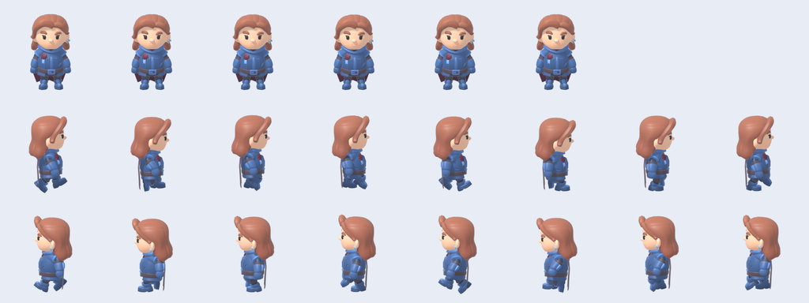
</p>

## Gallery

**The six bases:**

<p align="center">
  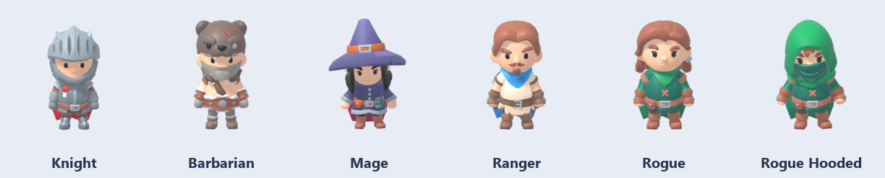
</p>

| | | |
|:-:|:-:|:-:|
| 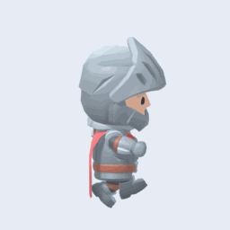<br>**Knight** | 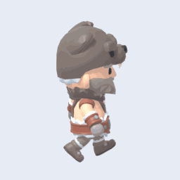<br>**Barbarian** | 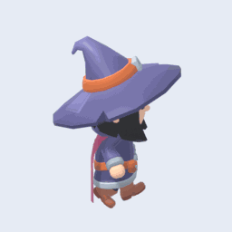<br>**Mage** |
| 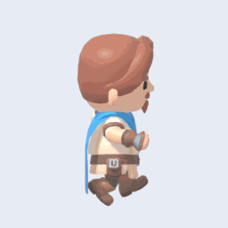<br>**Ranger** | 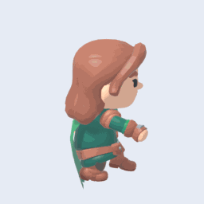<br>**Rogue** | 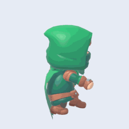<br>**Rogue Hooded** |

**Mixed, repainted and reshaped:**

<p align="center">
  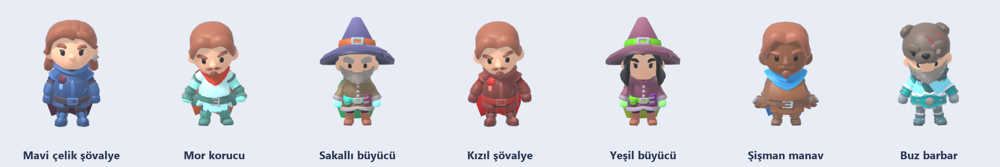
</p>

| | | |
|:-:|:-:|:-:|
| 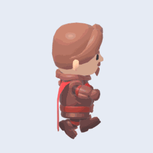<br>**Red knight** | 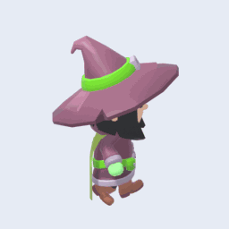<br>**Green wizard** | 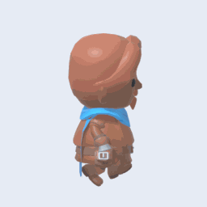<br>**Grocer** |
| 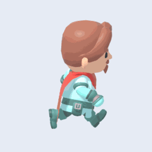<br>**Purple ranger** | 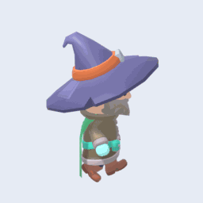<br>**Bearded wizard** | 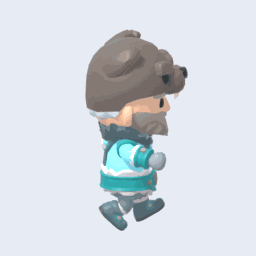<br>**Ice barbarian** |

## Under the hood

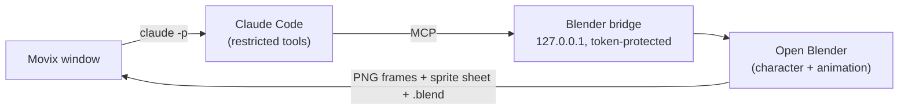

Claude reaches Blender through only three tools: run kit functions, take a preview, read scene info.
Its code passes a safety filter first; the bridge listens on `127.0.0.1` only and asks for a random token per session. The repo contains no API keys.

<details>
<summary><b>Project layout, tests and limits</b></summary>

| File | Purpose |
|---|---|
| `movix/app.py` | Window: request, 3 ideas, animation boxes, language button |
| `movix/i18n.py` | English / Turkish texts and the language setting |
| `movix/pipeline.py` | Pipeline: Claude → Blender → frames → save (repairs missing parts) |
| `movix/claude_runner.py`, `movix/prompts.py` | Headless `claude -p` calls (with step/time budget) and instructions |
| `movix/mcp_server.py` | The MCP server Claude talks to |
| `movix/blender_client.py` | Starts Blender and talks to the bridge |
| `movix/blender_side/real_kit.py` | Pick a character, mix parts, repaint, resize, choose motions |
| `movix/blender_side/kit.py` | Camera, light, preview, frame and sprite-sheet rendering |
| `movix/blender_side/bridge.py`, `code_guard.py` | Local server inside Blender and the code filter |
| `assets/kaykit/` | Characters and motions (CC0) |
| `docs/make_images.py` | Generates the images on this page |

```bash
python tests/run_tests.py          # unit tests + headless Blender test (does not call Claude)
python tests/e2e_real.py           # real end-to-end: Claude + live Blender (uses your account)
python docs/make_images.py         # regenerates the README images (needs: pip install pillow)
```

**Known limits:** Tested on Windows only. Everything starts from six ready-made bases: no new shapes, accessories or hand-held items, only mixed parts, colours and proportions.
Painted details (beards, hairstyles, faces) can only be changed by choosing another head. Motions come from a ready-made animation pack.
Result quality depends on your request and Claude's output that round; use "Request a change" to refine. Do not touch the Blender window while Claude is working.

</details>

---

# 🇹🇷 Türkçe

## Ne yapar?

Movix, tek cümlelik bir tarifi oyunun için **2B karakter animasyonlarına** (sağa yürüme, sola yürüme, sabit durma) çeviren küçük bir masaüstü uygulamasıdır.

*"Yeşil cübbeli neşeli bir büyücü"* yazarsın. **Claude**, açık bir **Blender** penceresinde altı hazır oyuncak tarzı karakterden en yakınını seçer,
parçalarını değiştirir, boyar ve ona yakışan bir yürüyüş seçer. Sonuç: **şeffaf PNG kareleri** ve bir **sprite sheet**.

| Sağa yürüme | Sola yürüme | Sabit durma |
|:-:|:-:|:-:|
|  |  |  |

<p align="center"><sub>"Mavi çelik şövalye": Knight zırhı maviye boyandı, Rogue kafası takıldı.</sub></p>

## Karakter nasıl hazırlanır?

Claude hiçbir şey modellemez. Hazır bir karakteri birkaç araçla düzenler:

| Adım | Araç | Ne yapar? |
|---|---|---|
| 1. Seç | `new_character` | 6 tabandan en yakınını yükler: Knight, Barbarian, Mage, Ranger, Rogue, Rogue Hooded |
| 2. Karıştır | `use`, `remove` | Kafa, gövde, kol, bacak, şapka, kask ve pelerinleri tabanlar arasında değiştirir (aynı iskeleti paylaşırlar) |
| 3. Boya | `swatches`, `replace_color`, `tint`, `shift_color` | Belirli bölgeleri (ten, saç, gömlek) ya da tüm parçaları boyar, boyalı detay kalır |
| 4. Şekillendir | `resize`, `scale_all` | Şişman, zayıf, iri kafalı, kısa bacaklı gövdeler |
| 5. Hareket | `animate` | Kişiliğe uygun yürüyüş ve duruş seçer (sakin, zıplayan, sinsi, koşan…) |

**Aksesuar, elde taşınan eşya ya da çanta yoktur**; tasarımı bozdukları için bilerek dışarıda bırakıldı.
Claude'a bir bütçe verilir (yaklaşık 16 araç çağrısı / 9 dakika). Aşılırsa karakter olduğu haliyle tamamlanır, yani her zaman bir sonuç alırsın.

## Kurulum

Windows PowerShell'de sırayla:

```powershell
winget install BlenderFoundation.Blender.LTS.4.5
winget install Anthropic.ClaudeCode
winget install Python.Python.3.12

claude                      # bir kez giriş yap (API anahtarı gerekmez, hesabınla girersin), sonra çık

git clone https://github.com/mhmtemnbgr1/MOVIX.git
cd MOVIX
python -m movix.app         # ya da Baslat.bat'a çift tıkla
```

`winget install` satırlarından sonra yeni programların bulunması için **yeni** bir PowerShell penceresi aç. Hızlı kontrol:

```powershell
python --version            # 3.10 ya da üstü
claude --version            # uygulamanın yönettiği asistan komutu
```

`winget` yok mu? Üç programı elle kur: [Blender](https://www.blender.org/download/) (4.2 ya da üstü), [Python](https://www.python.org/downloads/) (3.10 ya da üstü, *Add python.exe to PATH* kutusunu işaretle) ve [Claude Code](https://claude.com/claude-code).

`pip install` gerekmez; uygulama yalnızca Python'un standart kütüphanesini kullanır.
Pencere açılınca Blender kendiliğinden açılır. Üstte *Blender bağlı* ve *Claude hazır* yazısını görünce hazırsın. Blender başka bir yerdeyse **Blender seç…** ile `blender.exe`'yi göster.
Üstteki **🌐 EN / TR** düğmesi uygulamanın dilini değiştirir; seçimin hatırlanır.

**Sorun giderme**

| Sorun | Çözüm |
|---|---|
| Üstte *Blender bulunamadı* | **Blender seç…** düğmesine bas ve `blender.exe`'yi göster (genelde `C:\Program Files\Blender Foundation\Blender 4.5\`) |
| *Claude Code yok* | Yukarıdaki gibi kur ve uygulamayı yeniden aç |
| Açılıyor ama karakter yapılmıyor | PowerShell'de bir kez `claude` yazıp girişi tamamla, sonra tekrar dene |
| `python` tanınmıyor | Python'u kurduktan sonra PowerShell'i yeniden aç ya da *Add python.exe to PATH* işaretli olarak yeniden kur |

## Kullanım

1. Karakteri tarif et. Örn. *"yeşil cübbeli neşeli bir büyücü"*.
2. **★ 3 karakter öner** de, beğendiğinde **Blender'da yap →** düğmesine bas. (Ya da **Direkt yap**.)
3. Blender'da Claude'un karakteri seçip düzenlemesini canlı izle. İlerleme çubuğu ve canlı akış hep görünür.
4. Sağdaki üç kutucukta sağa yürüme, sola yürüme ve sabit durma döngüyle oynar.
5. Beğenmediğin yeri yaz, örn. *"pelerini mavi yap"*, ve **Uygula**'ya bas.

Kareler ve sprite sheet `Belgeler\Movix\Blender\<karakter>\` klasörüne kaydedilir.

## Galeri

Altı hazır taban karakter ve karıştırılıp boyanmış örnekler yukarıdaki İngilizce bölümdeki galeride, hepsi aynı yöntemle üretildi:
Knight, Barbarian, Mage, Ranger, Rogue ve Rogue Hooded; ayrıca Kızıl şövalye, Yeşil büyücü, Şişman manav, Mor korucu, Sakallı büyücü ve Buz barbar.

<p align="center">
  
</p>

## Arka planda

Claude, Blender'a yalnızca üç araçla erişir: kit işlevlerini çalıştırma, önizleme alma ve sahne bilgisi okuma.
Kod, çalışmadan önce bir güvenlik süzgecinden geçer; köprü yalnızca `127.0.0.1`'de dinler ve her oturum için rastgele token ister. Repoda API anahtarı yoktur.
Akış şeması yukarıdaki İngilizce bölümdedir.

<details>
<summary><b>Proje yapısı, testler ve sınırlar</b></summary>

| Dosya | Görev |
|---|---|
| `movix/app.py` | Pencere: istek, 3 öneri, animasyon kutucukları, dil düğmesi |
| `movix/i18n.py` | Türkçe / İngilizce metinler ve dil ayarı |
| `movix/pipeline.py` | Üretim hattı: Claude → Blender → kareler → kayıt (eksik parçaları onarır) |
| `movix/claude_runner.py`, `movix/prompts.py` | Başsız `claude -p` çağrıları (adım/süre bütçeli) ve yönergeler |
| `movix/mcp_server.py` | Claude'un konuştuğu MCP sunucusu |
| `movix/blender_client.py` | Blender'ı başlatır ve köprüyle konuşur |
| `movix/blender_side/real_kit.py` | Karakter seçme, parça karıştırma, boyama, ölçekleme, hareket seçimi |
| `movix/blender_side/kit.py` | Kamera, ışık, önizleme, kare ve sprite sheet çizimi |
| `movix/blender_side/bridge.py`, `code_guard.py` | Blender içindeki yerel sunucu ve kod süzgeci |
| `assets/kaykit/` | Karakterler ve hareketler (CC0) |
| `docs/make_images.py` | Bu sayfadaki görselleri üretir |

```bash
python tests/run_tests.py          # birim testleri + başsız Blender denemesi (Claude çağırmaz)
python tests/e2e_real.py           # gerçek uçtan uca: Claude + canlı Blender (hesabını kullanır)
python docs/make_images.py         # README görsellerini yeniden üretir (pip install pillow gerekir)
```

**Bilinen sınırlar:** Yalnızca Windows'ta denendi. Her şey altı hazır temel karakterden başlar: yeni şekil, aksesuar ya da elde eşya yoktur; yalnızca karıştırılmış parçalar, renkler ve oranlar vardır.
Boyalı detaylar (sakal, saç stili, yüz) yalnızca başka bir kafa seçilerek değişir. Hareketler hazır animasyon paketinden gelir.
Sonuç kalitesi isteğe ve Claude'un o turdaki çıktısına göre değişir; "Değişiklik iste" ile düzeltilir. Claude çalışırken Blender penceresine elle dokunma.

</details>
